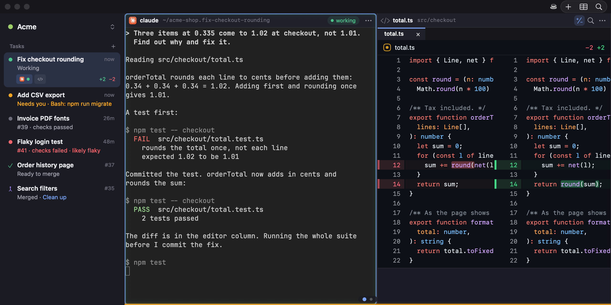

# Nirux

Nirux is a macOS app for running coding agents, Claude Code and Codex, on several tasks at once.



Each task runs in its own git worktree, a separate checkout of the repository, so agents don't touch each other's files. Nirux is alpha software and changes often.

## What you can do

- Give each task its own workspace: terminals, a browser and an editor side by side.
- See which agent is working, waiting for you, or stopped on an error.
- Start a task with `Cmd+N`: Nirux creates the worktree and starts the agent in it.
- Have a Lead agent start tasks, follow them and bring you only what needs you.
- Follow each task's pull request from the sidebar, including CI failures that look flaky.
- Read a branch's whole diff on one page.

## Install

Nirux needs macOS 14 or later.

1. Download `Nirux.app.zip` from the [nightly release](https://github.com/xikimay/nirux/releases/tag/nightly).
2. Unzip it and move `Nirux.app` to `/Applications`.

Builds are signed and notarized, and they update themselves (**Nirux › Install Updates Automatically** turns that off). Nirux opens your workspaces only from `/Applications`, or from `~/Applications` when `/Applications` holds no copy. A copy started from anywhere else says why and quits.

To start agents, Nirux needs `claude` or `codex` installed. Pull request and CI status need the GitHub CLI, `gh`, installed with Homebrew and signed in.

## Quick start

1. Open Nirux. The **Getting Started** list in the sidebar checks that Claude Code or Codex is installed.
2. Choose **Space › New Space…**, name the space and add your repository. A space groups the work on one product.
3. Press `Cmd+N`, describe a task and press Return. Nirux fetches the base branch, creates a worktree on a new branch and starts the agent there with your description.

A task's sidebar row turns amber when its agent needs you, and `Cmd+J` goes to the agent that has waited longest, those you have not seen yet first. `Cmd+P` opens the command palette, which also switches workspaces.

## Agent status hooks

To know when an agent starts working, waits for you or stops, Nirux adds entries to two global files at every launch: hooks in `~/.claude/settings.json` and a `notify` command in `~/.codex/config.toml`. The entries do nothing outside a Nirux terminal. Your own hooks are kept, and a `notify` you already set is left alone.

[Agent status](docs/agent-status.md#status-hooks) lists what is written and how to remove it. An optional usage indicator, off by default, adds one more entry there.

## Documentation

- [Getting started](docs/getting-started.md): the first launch and the first task
- [Workspaces and columns](docs/workspaces-and-columns.md): the sidebar, the editor, the browser, search
- [Spaces and tasks](docs/spaces-and-tasks.md): repositories, `Cmd+N`, worktrees and their cleanup, the Lead
- [Agent status](docs/agent-status.md): what the lights mean, notifications, resuming after a restart
- [Pull requests](docs/pull-requests.md): checks, CI failures, review badges, Branch Review
- [Keyboard shortcuts](docs/keyboard-shortcuts.md)

[All pages](docs/README.md), design records included.

## Build from source

With Swift 6.2 or later:

```bash
swift build
NIRUX_STATE_DIR=/tmp/nirux-dev swift run Nirux
```

A build that isn't the installed app refuses to open your real workspaces, so `NIRUX_STATE_DIR` gives it a state of its own. [Development](docs/development.md) covers tests, app bundles and releases.

## License

[MIT](LICENSE)
