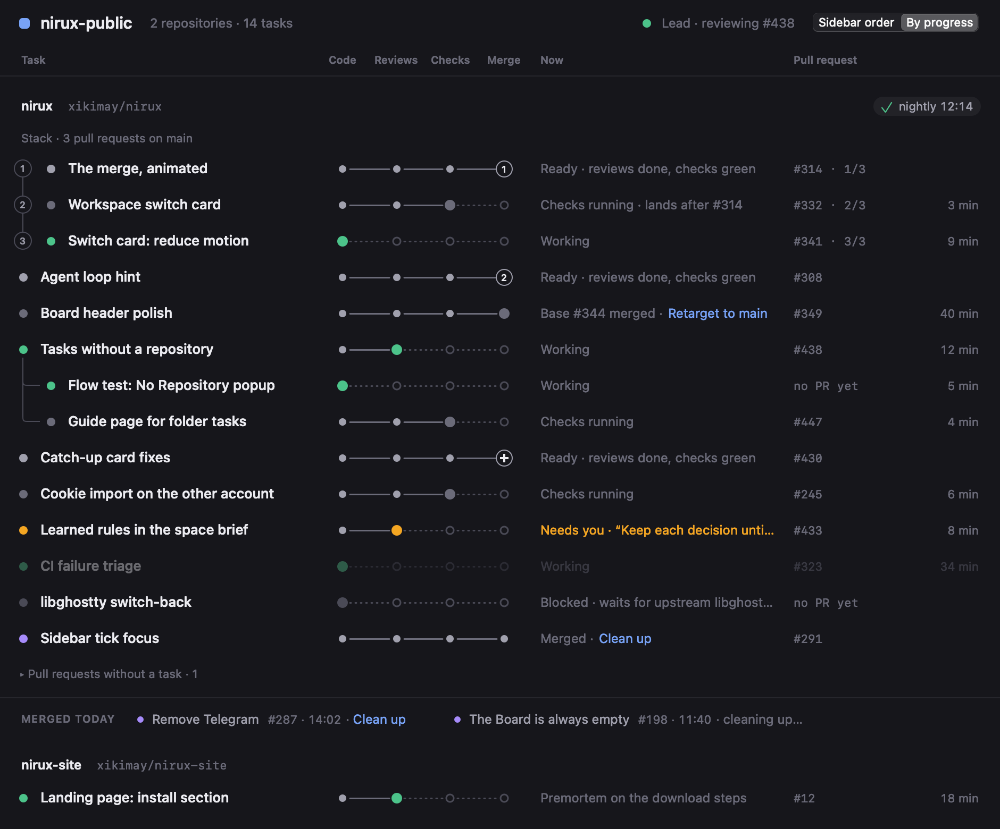
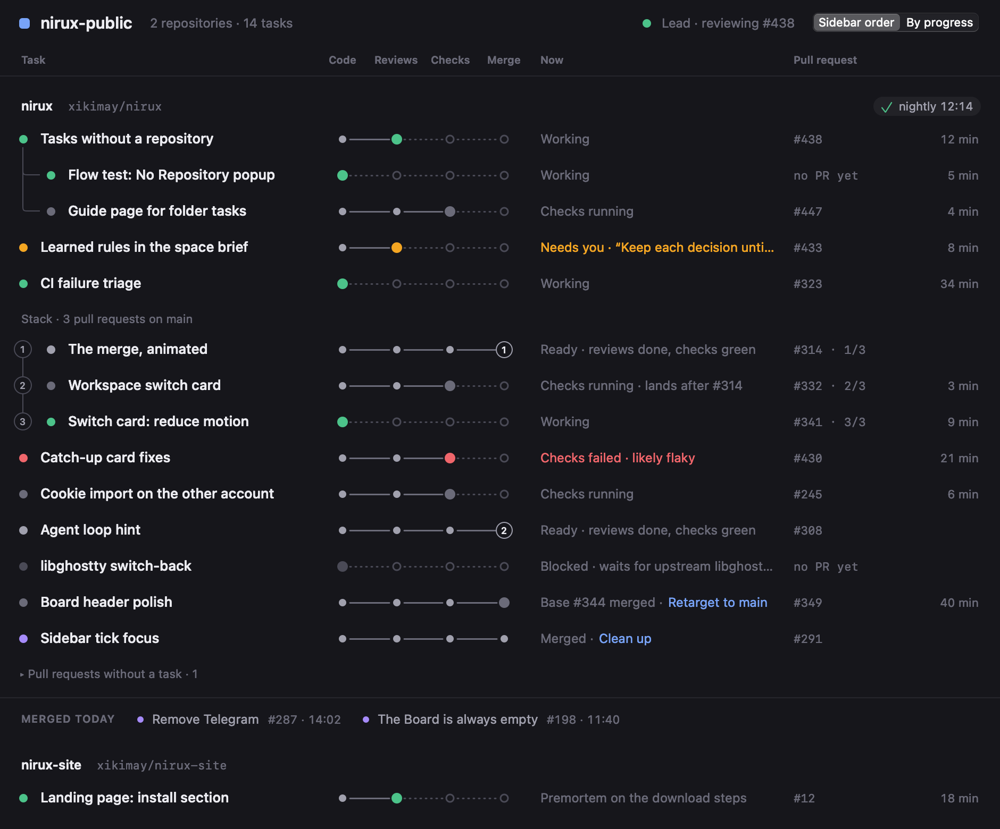
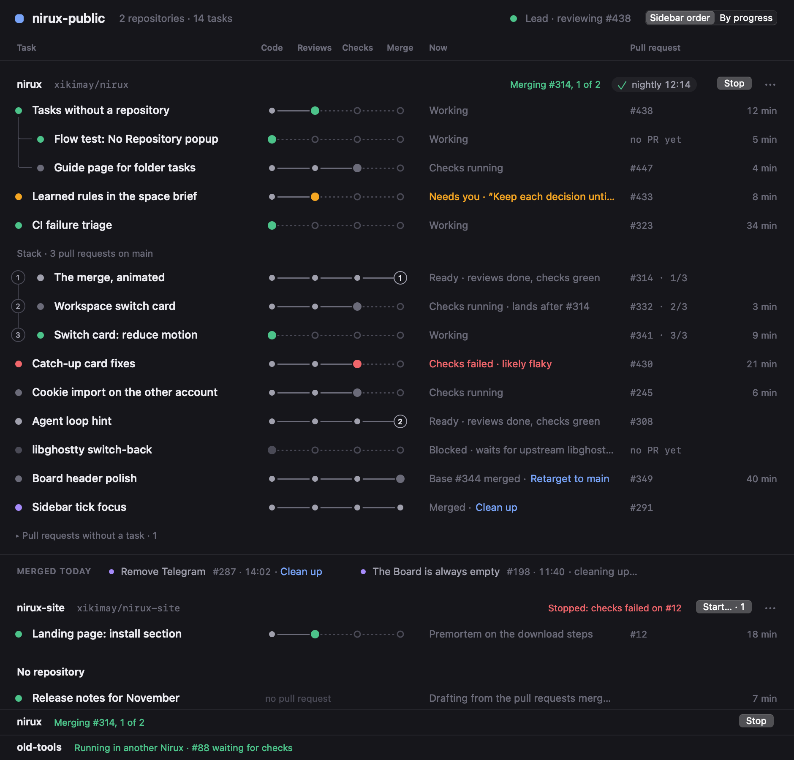
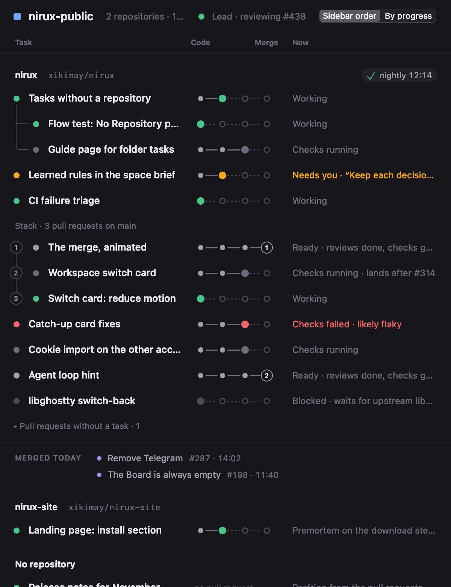
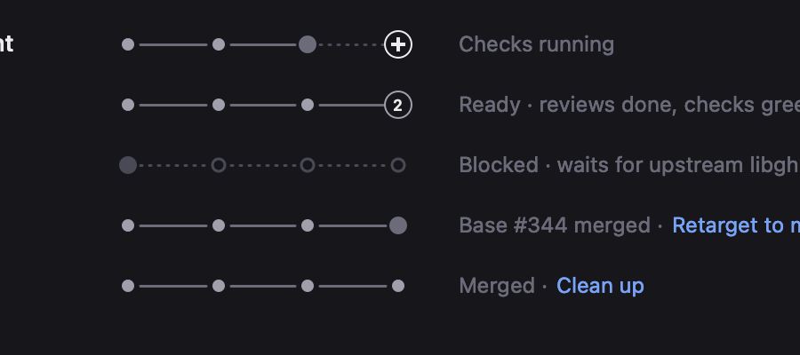

# Board Stages

> **Design record:** in progress. The model, the view and what fills them are in the app; the Board's column doesn't show them yet.\
> **Differs today:** the Board is still the table of [Project Board](project-board.md), one per project.\
> **User guide:** [Pull requests](../pull-requests.md#the-board).

Status: design validated by the user on 2026-11-11 (study D). The model
(`BoardStages`: lines, units, sections), the view (`BoardStagesView`) and the
facts read from today's Board (`BoardStages.sectionFacts`) are implemented;
the Board's column still shows the table, and the per-space Board follows.

The Board was a table built for the merge queue: one row per branch, with
Agent, PR, Checks and Queue columns. It didn't say where a task stands, nor
what comes next. It becomes the overview of a space:

- **One Board per space**: a section per repository, then the tasks without one.
- **One line per task**: its state and title, a rail of four stations, one
  phrase, its pull request, a time.
- **Linked tasks stay together**: a sub-task under its task, a stack of pull
  requests on a numbered rail in merge order.
- **It shows, it doesn't ask**: no card to answer an agent from. A click on a
  line opens the task. The merge queue keeps its list, its sheet and its rules.

## Decided

- **Four stations, the same for every task**: Code, Reviews, Checks, Merge.
  The current one is the first not done.
- **A commit doesn't send a line back.** Reviews is done once a code review
  ran in the task, on any commit, and its turn is over: fixes always follow a
  review. The station's tooltip then says the review ran on another commit;
  no mark is drawn for it, since it would be on most lines.
- **Which reviews count, and whether they must be on HEAD, are two constants**
  (`BoardStages.Rules`), built to become space settings.
- **Amber means an agent waits for the user**, and nothing else. It is never
  hidden, even once the pull request merged.
- **The queue's list stays the user's.** The number on the Merge station is a
  pull request's place in that list.
- **One reading per line**: its state, its phrase and its clock come from one
  ladder, so they can't disagree.

## 1. Stations

| Station | Done when | Read from |
| --- | --- | --- |
| Code | A review pass that counts ran in the task (on any commit), or its pull request is open and not a draft | Review badges ([review-badges.md](review-badges.md)); the Board's open pull requests |
| Reviews | Each pass that counts ran, and its turn is over | Review badges; the turn that started the pass |
| Checks | The pull request is open, every required check is green and none is red; with no required check, none still runs | The pull request's check rollup; `requiredChecks` of board.json |
| Merge | The pull request is merged, and the queue is through with it | The Board's merged pull requests; the merge queue |

- Only a pass that counts ends Code: a prompt that merely names an adversarial
  review records one.
- A review pass is recorded when it starts. Until its turn is over, Reviews is
  the current station, whatever the agent does meanwhile (a permission to
  allow, say). A pass started again is waited for again.
- A pull request the running queue works on is where the queue has it: Checks
  while it updates the branch or waits for checks, Merge while it merges and
  until the post-merge run ends, though GitHub says merged within a minute:
  its number stays on the Merge station meanwhile. A post-merge failure keeps
  it at Merge, in red; a stop from before its merge says nothing once it
  merged. The user confirmed its head at Start, whatever its reviews.
- **No Reviews station**, drawn as a gap, where no review is waited for or
  none was seen: a pull request with no workspace here, one the queue took or
  that merged before a review that counts ever ran, rules that ask for none.
  The rail never claims a review that didn't run.
- A task without a repository has no rail.

## 2. States

The line's dot and its current station take the state's colour. The first that
holds, in the sidebar row's order:

| State | Colour | When |
| --- | --- | --- |
| Needs you | amber | An agent waits for the user: a permission, a question, a plan |
| Failed | red | An agent stopped on an error or exited mid-turn |
| Working | green | An agent works |
| Waiting | grey | The running queue works on its pull request |
| Failed | red | Its open pull request conflicts with its base, or has a red check; else the last queue stopped on it. What is wrong now comes before what stopped a queue |
| Waiting | grey | Its agent asked the agent that started it |
| Blocked | dim | A blocker is set |
| Merged | purple | Its pull request merged |
| Idle | grey | Its base is a merged pull request's branch: the user retargets it |
| Waiting | grey | At Checks: checks run, or a required one hasn't reported. At Merge: the pull request before it in its stack hasn't merged |
| Idle | grey | At Merge and held: a draft, another base than the queue's, changes requested, a review required, review comments to answer |
| Ready | light | At Merge, and nothing holds it |
| Idle | grey | Nothing above |

A red check or a conflict shows at any station: the phrase says which.

## 3. Phrase, pull request, clock

The phrase is the state's own line of the ladder:

- "Needs you · a question"; the agent's failure; "Working", or what the user
  wrote of the task;
- the queue's step ("Updating branch", "Waiting for nightly");
- "Conflicts with main"; "Checks failed: test", or "Checks failed · likely
  flaky" when the [triage](ci-failure-triage.md) said so; "Queue stopped:
  changed";
- "Asking Lead"; "Blocked · …";
- "Merged", "Merged · Clean up", "Merged · cleaning up…";
- "Base #52 merged · Retarget to main" ([stacked pull requests](pr-stacks.md)),
  or "Base #52 merged" alone where nothing here can retarget it (section 7);
- at Checks, "Checks running", or "No test run yet" while a required check
  hasn't reported, each followed by "lands after #52" in a stack;
- at Merge, "Lands after #52", "Draft", "Targets release", "Changes
  requested", else "Ready". "Ready" and "Draft" add what the pull request
  passed, and only that: "Ready · reviews done, checks green";
- at rest, "Next · …" (the user's next step, else the Lead's), else what the
  user wrote of the task, else where it stood when its last turn ended, else
  what the station needs: "No code review yet", "No pull request yet".

"Clean up" and "Retarget to main" are links: the one click that moves the line
on. A branch a phrase names ("Targets release", "Retarget to main") is shown
cleaned: it is named on GitHub, by whoever pushed it. While an agent works the line says "Working", or the user's own summary
of the task: the last turn's line is about the turn before.

The pull request cell reads "#52", "#53 · 2/3" in a straight stack, "#53 · on
#52" in a fork, "no PR yet".

The clock counts from the turn's start while an agent works, from the checks'
while the line waits for them, else from the last activity (as for a turn
whose start isn't known). A line that is
ready, blocked, merged or in the queue's hands has none.

## 4. Units, sections, orders

A section is one repository of the space, or its tasks without one. Inside,
lines that are linked never part, each keeping its own state
(`BoardStages.section`):

- **A task and its sub-tasks**: the tasks listed under it in the sidebar,
  depth first, each joined to it by an elbow. A sub-task whose task isn't in
  the section (another repository, closed) stands alone.
- **A stack of pull requests**, under "Stack · 3 pull requests on main", on a
  numbered rail in merge order ([stacked pull requests](pr-stacks.md)). A
  fork (two pull requests on one branch) has no single order: its lines stay
  apart, and their cells say "on #52".
- **The family wins.** A line is drawn once. A stack is a unit of its own only
  when none of its lines is in a family here; else the lines stay in their
  families, and their pull request cells ("#53 · 2/3") and phrases ("lands
  after #52") say the stack.
- **Pull requests without a task** (no workspace here: a cloud session's)
  close the section, folded, as lines without a Reviews station. A stack with
  one task at least stays whole in the list, even where a family keeps its
  lines apart.

Two orders, one setting for the app:

- **Sidebar order**: each unit at the place of its first line.
- **By progress**: the closest to its base branch first, by what doesn't
  change with each turn of an agent. The pull request the queue works on comes
  first; then the queue's list, in its order, whatever station each is at;
  then the lines by station, one with a blocker below Code. A unit counts as
  its furthest line; ties keep the sidebar's order. Last come the lines
  nothing is left to follow for: a pull request merged and through the queue,
  then an archived task.

**Nothing moves under the pointer** (the Lead's rule, 2026-11-13). While the
pointer is over the Board, header included, what it shows keeps its place,
whatever the content brings (a click on a Merge station sends a line up By
progress; a pull request lands and leaves the list; a turn, a check, the
sidebar move others):

- a line still there stays where it was, in its new state;
- a line gone stays there too, faded and inert (no click, a press already
  under way included, no station, no link, no hand, no menu, nothing for
  VoiceOver), so that nothing below it moves up; a repository gone leaves its
  lines so, under a header that does nothing (no queue, no Start, no menu);
- a running queue's line at the Board's foot that ends stays there too,
  faded, without Stop: the list above would grow and, scrolled to its end,
  move; a queue that starts waits for its line, as its header says it runs;
- what comes waits: a line, a sub-task, a repository, a merge; "Merged
  today" keeps its entries in their order, in their new state, amber
  included (amber comes first again once the Board settles).

Once the pointer leaves the Board, or the Board hides, or the app isn't the
active one any more (its windows don't hear the pointer leave), it settles,
once the event that said so is over. The order switch is the user's own
click: what it asks applies at once, for the change that brings it only; an
order that changes otherwise (another Board's switch) is held. Left for the
Lead: a pointer resting on the Board while the user types elsewhere holds it as
long, new tasks waiting; and the Board knows the pointer by where it is, not by
what covers it (a window over it).

**Merged today** closes the section: the pull requests merged since midnight,
the newest first, each with its task's title while that task is open, its
"Clean up" while its worktree is there, and amber while an agent of its task
needs the user (the view lists those first: section 5).

- A pull request has one place. Its line leaves the list for this one once
  the queue is through with it (after the post-merge run), and doesn't come
  back with its agent's next turn: lines don't change place with each state.
- A merged task stays a line while a sub-task of it is listed: a family stays
  whole.
- One merged before today whose task is still open is a line, "Merged · Clean
  up": at midnight, the day's merged tasks not cleaned up return to the list.

## 5. The view

`BoardStagesView` draws what the model decided, natively, and says what was
clicked. The sizes are the mockup's.

- **The space's header** stays in place: its colour and name, what it holds,
  its Lead's state and line, the order switch. Under it, the columns' titles,
  each station's over its place on the rails. On a narrow Board they give way
  in this order: the summary, the Lead's line, the order switch; the name is
  the last to (a name longer than 160 pt keeps that much beside the switch).
  The Lead's dot keeps its place, in its state's colour, and says its line
  under the pointer. The order switch shows the content's order: it moves once
  the owner shows the order asked.
- **A section per repository** scrolls below: its name, `owner/name`, its
  post-merge run's pill (or what went wrong reading it), then at its right
  what its merge queue does ("Merging #52, 1 of 2", "2 pull requests
  queued", "Stopped: …", in green while it works, red when a problem
  stopped it, never amber), a DRY RUN badge (an outline, not a colour) in a
  build that can't change GitHub, Start… · N (N the pull requests the Board
  shows a place for: merged ones count for none, so only merged ones left
  means nothing to start) or Stop while it runs here, and "⋯", its menu
  (Board Settings…, Open Main Checkout), also on a right click. On a narrow
  Board what can be done stays ("⋯", Start or Stop, in one place the wider
  of the two takes, so that nothing left of it moves when one becomes the
  other), then the name, 80 pt of it at least; then, while there is room, in
  this order: DRY RUN, the queue's words (whole, or cut down to 60 pt), the
  pill (two fifths of the header at most), `owner/name` (from 30 pt); once
  one doesn't fit, none after it shows. What went is said under the pointer
  on the header. (`BoardStagesView.sectionQueue` says it by the table's
  rules: a problem's words alone in red, what is queued then on Start.)
- **A queue that runs**, here or in another Nirux, keeps a line at the
  Board's foot (its repository, what it does, in green as its header says
  it, Stop where it runs here), orphans
  included (their repository says why under the pointer): Stop stays in
  sight while the list scrolls, and since it takes the foot, nothing above
  moves when it comes or goes. A Board too short for them all shows as many
  as there is room for under its header.

  

- **A line** is 34 pt: its state's dot and its title, its rail, its phrase
  (amber or red when it needs a look, else grey), its pull request, its time.
  A press and its release on it open the task, but on its Merge station and
  on the link ending its phrase, which are targets of their own (section 7).
  A text that is cut shows whole under the pointer, and with the phrase what
  it can't hold (why the checks look flaky, why the queue stopped).
- **The rail**: a filled dot for a station done, a larger one in the state's
  colour for the current one, a hollow one ahead, nothing where there is no
  Reviews station; solid up to the current station, dotted after. The queue's
  number sits in a ring on Merge, in the state's colour when the line is
  there.
- **A sub-task** sits in from its task, joined by an elbow; **a stack's** lines
  sit on a rail numbered in merge order, under the stack's title.
- **Pull requests without a task** start folded, each time the Board opens,
  under a line that counts them.
- **Merged today** keeps to two rows, then "+12 more": a day of twenty merges
  doesn't push the next repository off the Board. Each entry is its dot
  (amber while its task needs the user), its title, then its number and time,
  and "· Clean up" while its task's worktree is there ("· cleaning up…"
  while one runs, in the same room: the entries after it don't move under
  the pointer). The title gives way first, down to 40 pt, then the link goes
  whole; the number and the time last. A title that is cut is whole under
  the pointer anywhere on the entry but on "Clean up". When a clean-up
  ends, its words go and the entries after it close up. One whose task is
  still open opens it. Those whose task needs the user come first (but while
  the pointer is over the Board: section 4), so amber is never behind the
  button; were there more of
  them than two rows hold, the button says so, in amber ("+12 more · 3 need
  you").
- **It follows its content without building itself again.** A refresh that
  only moves the clock touches the times that changed. A change of lines
  updates them where they are: what is still listed keeps its view (a line,
  a repository's header, its fold, a stack's title, a merged entry), so a
  press in flight on a line or an entry, or the keyboard on a fold, isn't
  lost, and the views stay in the order they are read.

**On a narrow Board** the columns give way in this order, and never by a jump
(from where a phrase shows, widening the Board moves no rail back and shortens
no title):

- the task's column is two fifths of the Board, 280 pt at most, so a wide
  Board doesn't push the rails away from the titles;
- below about 760 pt the rail tightens, its stations closer, down to 116 pt at
  600; a tight rail names its two ends only;
- the phrase takes the rest; the pull request shows once the phrase keeps
  180 pt beside it (from about 830 pt), then the time (from about 900 pt): at
  those two widths the phrase gives them 128 pt, then 64 pt;
- under 70 pt a phrase says nothing: it goes (below about 390 pt), and the
  title takes its place;
- below about 300 pt there is no room for a rail beside a title: a line keeps
  its dot and its title.

## 6. Where the facts come from

`BoardStages.sectionFacts` fills a section's facts from what the app already
holds: the rows of today's Board ([project-board.md](project-board.md),
section 2), its merge queue's state, the merged pull requests read, the
space's tasks in the sidebar's order, and what each task's sidebar row last
read. Pure; nothing is read again.

- **Lines.** Each task whose workspace is in a row of the repository is a
  line, in the sidebar's order (the rows are in pull request order). The Lead
  is no task: it isn't in the list given. Two tasks sharing a worktree are two
  lines, on the same pull request. An open pull request no task's line shows
  is a pull request without a task: after the tasks, in the rows' order, once,
  named by its title. A main checkout or a worktree with neither is no line.
- **A task says what its sidebar row read**: what its agents do, its reviews,
  its texts. One the sidebar hasn't read yet is a line at rest. What the
  sidebar read of git in another worktree (the task's focused column is
  elsewhere) is left out: the pull request there, what GitHub asks of it, why
  its checks look flaky, its clean-up, and the HEAD the reviews would be
  fresh on.
- **A sub-task** is under its task when both are lines of the section.
- **A merged pull request stays on the task the queue left behind.** The row
  has it while the worktree is at its head. The queue's own branch update
  leaves the worktree a commit behind, at a head the queue knew: then it is
  that branch's pull request in the queue shown, once it merged (as the queue
  saw it; or as GitHub's list says, at a head the queue knew, when its merge
  went unanswered). Else it is the one the task's own detection says merged.
  One the queue merged reads merged at once, before GitHub's list says so; so
  does one the merged list has while the open list, read before it, still
  does. A project's worktree whose pull request merged offers the clean-up.
- **Checks are counted by the merge queue's rules**
  ([project-board.md](project-board.md), section 3.2): the latest run of each;
  every check of a required name green, and one that hasn't reported waited
  for; a required one that ended skipped or neutral counts as failed, since no
  wait turns it green; a red check by name, required or not. Without a
  required check, every check counts: none may still run.
- **The queue.** In the queue shown while it runs, here or in another Nirux,
  a pull request's place is the queue's own ("3 of 7") and its step shows; its
  number stays through the post-merge wait, and goes once the queue is through
  with it. One that isn't in that queue has no place meanwhile: the numbers
  are one list's. Else its place is the next Start's, counted without those
  that merged: by the queue, or as the merged list, a row or a task's own
  detection says (by hand, say). The list holds those until Start, whose
  sheet drops them.
- **A queue's stop** a push answers (its checks, a conflict, a merge or an
  update that failed, commits not pushed, a busy agent) is over once the pull
  request's head moved. The others stay until the next Start: "changed" is
  itself a head that moved, and a draft or another base is no commit's. After
  its merge, every stop stays: something still needs a look.
- **Merged today** is the merged list's pull requests that have a merge date,
  a fork's included, with their title.
- **No rail** where no pull request is read, and none is looked up there: a
  workspace in another repository or in none, a section whose repository
  isn't on GitHub, and any section until its open pull requests were read
  once.

Still to come with the Board's column: the tasks' readings filled from the
sidebar, kept from one sidebar pass to the next and for a space that isn't on
screen.

## 7. What a line offers

The model says what a click does and what shows under the pointer
(`Line.offer`, `Phrase.link`, `Line.tooltips`), and the line draws it and
says what was clicked (`BoardStagesView.onOffer`, `onLink`). Nothing is wired
to the queue yet.

- **The Merge station is the control of the queue's list**, which stays the
  user's. A pull request outside the next Start's list joins it by a click on
  its Merge station, at whatever station its line is: the queue asks for no
  review, and waits for the checks itself. One in the list leaves it by a
  click on its number.
  - **Refused**, in the queue's own words (`ProjectBoard.queueRefusal`):
    "Can’t join the queue: draft", another base ("after #52", "targets
    release"), a conflict, an agent at work in its worktree. One already in
    the list can still leave it. Only what the queue's rule refuses without
    a call: a red check or a review GitHub asks for keeps nothing out of the
    list, and the Start sheet checks the rest.
  - **Locked** while a queue runs, here or in another Nirux, and while the
    confirmation sheet is open: the sheet shows the list as it was when it
    opened. The station says which, after what the queue's rule refuses:
    that doesn't end with the queue.
  - **Nothing to click** without an open pull request, and in a repository
    that isn't saved in Board Settings, which has no merge queue.
  - **In the view**, the station is a target 22 pt wide, the line's height,
    while a click there acts; elsewhere, and where it is refused or locked,
    it is the line's. Under the pointer it says what a click does: a plus
    in a ring to join, a minus in place of its number to leave. The ring
    is bright, or keeps the state's colour when the line is at Merge: amber
    is never hidden.
  - **A click** is a press and its release on the station, where the line
    is in sight, while it still offers what was pressed: a list locked
    meanwhile, or a pull request that joined it, changes nothing. The
    station acts at each click (a second one, at once, takes back the
    first); a double click opens a task, or follows a link, once.
  - **The Board follows the pointer**, not each line: lines move under a
    still pointer (a new order, a scroll, a resize), which no event of
    theirs says. It asks where the pointer is after each of those, and
    lights the one station under it; none while the Board is hidden, nor
    while the app isn't the active one, whose windows don't hear the
    pointer leave.
- **Retarget** bases a pull request on its merged base's base, on GitHub.
  - In a repository that isn't saved, the phrase reads "Base #52 merged",
    without what nothing here can do; so does one the queue's list holds, or
    the queue works on: it leaves the list first, by its Merge station.
  - While the list is locked (a queue runs, here or in another Nirux, or the
    Start sheet is open), it waits as adding and removing do; in a build that
    can't change GitHub (a dry run), it does nothing. Either way the words
    stay, as what to do, and are no link: the phrase's tooltip says why, as
    the menu's item does.
  - The link is the phrase's. A line that says something more pressing (a red
    check, an agent at work) has none: Retarget is in its menu.
- **A link says what its click does** under the pointer: "Bases #53 on main,
  as GitHub does when a merged branch is deleted"; "Checks the worktree, then
  asks what goes". It is drawn apart, in the accent colour, right after the
  words before it (`Phrase.wordsBeforeLink`). On a narrow Board those give
  way, down to nothing when a letter or two is all the room they have, and
  the link stays whole while the phrase's column holds it. A link too long
  for the column (a long branch's name) is cut, and leaves its words half
  of it, from 120 pt. Where any of the phrase is cut or gone, its words and
  its link say it whole under the pointer, the link before what its click
  does. The link's target is the line's height, over its own words.
- **Under the pointer**, what the line can't hold:
  - its title: the task's branch and worktree ("feat/login ·
    /Users/me/app.feat-login"), with "main checkout", "not checked out" or
    "folder is gone" where it applies;
  - Reviews: each pass that ran, "Code review ran on another commit",
    "Premortem ran on this commit", "Adversarial review running" (no commit
    is named while HEAD isn't known), and each pass asked for that didn't,
    "No code review yet". Another commit, not an earlier one: HEAD may have
    moved back;
  - Checks: the latest run of each check by name, with its result: those that
    hold the pull request first (the red ones, a required one that ended
    skipped or neutral), then the required ones no check reported ("nightly:
    no run yet"), those it waits for, then the rest. Twelve, then "and 5
    more"; a workflow's name and a job's are each cut at 40 characters,
    before the result;
  - Merge: what a click does, "Add to Queue" or "Remove from Queue", or why
    it does nothing;
  - its pull request: its stack ("Stack: #52 → #53 → #54, on main") and its
    address.

  Each place says its own: the title, the phrase, the link, the pull request,
  and each station over 22 pt around it. A place that stays keeps its
  registration: a tooltip being read stays up while its words change, or
  another place comes or goes.
- **"Merged today"** offers the same link on an entry: "Clean up" is a
  target of its own, the entry's height, with its hint, its hand and its
  VoiceOver action; the rest of the entry opens the task. An entry that went
  behind "+12 more", or left the list, between a press and its release opens
  nothing, nor do VoiceOver's press and action. Where the entries go (beside
  the caption or under it) doesn't depend on their links: a clean-up that
  ends moves nothing below. On a Board too narrow for a link beside the
  caption, the entry shows none. `onLink` then names the entry's task's
  line, which has left the list by then.
- **The line's menu** (a right click, or VoiceOver's "show menu") offers
  what its phrase may not say, in this order, each item carrying what acting
  needs (`MenuItem`):
  - Open Pull Request, for an address of github.com only (whoever posted the
    pull request can't send a click elsewhere);
  - Add to or Remove from Queue, as the Merge station;
  - Retarget to main, while the pull request is outside the queue's list
    and the queue doesn't work on it;
  - Resume, as the sidebar offers it for a stopped agent of the task, whatever
    another agent of it does: its column, and after an error the failed turn
    it answers, so that only that one is resumed (without it, Resume does
    nothing);
  - Clean Up… of the line's worktree, or of a folder already gone, as the
    table offers it, with its path;
  - Open, a shell where no workspace is open in the worktree (the main
    checkout included), with its path and its branch for a title.

  What does nothing for now is there, disabled, and says why under the
  pointer: refused or locked, a dry run, a Resume the sidebar holds back
  ("Resuming…"), a clean-up of that worktree that runs (known by its path,
  for every line in it; the phrase and "Merged today" then say "cleaning
  up…", with no link). A menu shown before the line changed acts only as
  the line, still on the Board, still offers; each of its items stays what
  it was. A worktree no line holds (a merged task closed since) gets its
  menu with "Other worktrees" (2b-4). `BoardStagesView.onMenu` has no owner
  yet.
- **VoiceOver** reads a line as one button, which opens the task; the Merge
  station's click and the link are its actions, by name ("Add to Queue",
  "Retarget to main"), and do what a click then does. Where the station
  refuses, the line's help says why.
- **A hand** shows where a click does something of its own: on a station
  that acts, on a link, as far as the line is in sight. A line or an entry
  asks AppKit for its places again whenever they are no longer those it
  gave.

## Known limits

- **Reviews Nirux can't see.** Codex has no prompt hook, and a `claude -p`
  review run from a shell doesn't count ([review-badges.md](review-badges.md)):
  such a task stays at Reviews, "No code review yet".
- **Review badges are kept per workspace**, each pass's latest run only. A
  workspace that moves on to another branch keeps the reviews of the first;
  closing the workspace that ran the review loses it; and a second run of a
  pass puts the line back at Reviews until its turn ends.
- **A review that died** (its turn stopped on an error) still counts once a
  later turn ends: nothing records that a review finished.
- **Checks and reviews are about two commits**: the rollup is of the pull
  request's head on GitHub, the badges of the local HEAD.
- **A queue's stop stays** on its pull request until the next Start; one a
  push answers, until the pull request's head moves; one from before its
  merge, until it merges (section 6).
- **The queue's knowledge ends at the next Start.** A task the last queue
  left a commit behind reads "No pull request yet" again once another queue
  starts, and comes back to the list, while "Merged today" keeps its pull
  request under its own title.
- **A merge the queue sent and never saw answered** (Nirux quit, or Stop was
  pressed meanwhile) reads a settled "Merged": as far as the queue knows, its
  stop is from before the merge.
- **"Merging" also shows** while the queue waits for a run on the base before
  it merges, as in the table.
- **"Merged today" lists what the Board read**: the 100 merged pull requests
  opened last and the 100 updated last ([project-board.md](project-board.md),
  section 6). One merged today is missing only if it is behind 100 merged
  ones opened since, and 100 merged pull requests were updated after it:
  merged, commented on, reviewed, labelled, locked, or their branch deleted.
- **Checks are read from the pull request's rollup**, which doesn't say a
  commit status from a check run, nor two workflows of one name apart. A
  required check that only a commit status reports reads green here, while the
  queue waits for a check run of that name; of two workflows named alike, only
  the later run of a job counts; and a completed run whose conclusion the
  Board doesn't know reads as still running, where the queue refuses it.
- **A pull request without a task doesn't know what GitHub asks of it**:
  changes requested or a review required show on a task's line only.
- **A pull request merged by hand after its branch moved** (GitHub's "Update
  branch", a commit made since) is no longer on its task: the line reads "No
  pull request yet" while "Merged today" has it under its own title. Only the
  queue's own update is followed.
- **Between two reads**, a pull request that just left the open list isn't in
  the merged one yet: its task reads "No pull request yet" until the merged
  list is read again.
- **A Board too short for its running queues' lines** shows those that fit,
  in their order: one ended under the pointer, faded, can take the place of
  one that still runs. A Board narrower than a header's buttons (about
  130 pt) lets Start go past its left edge.
