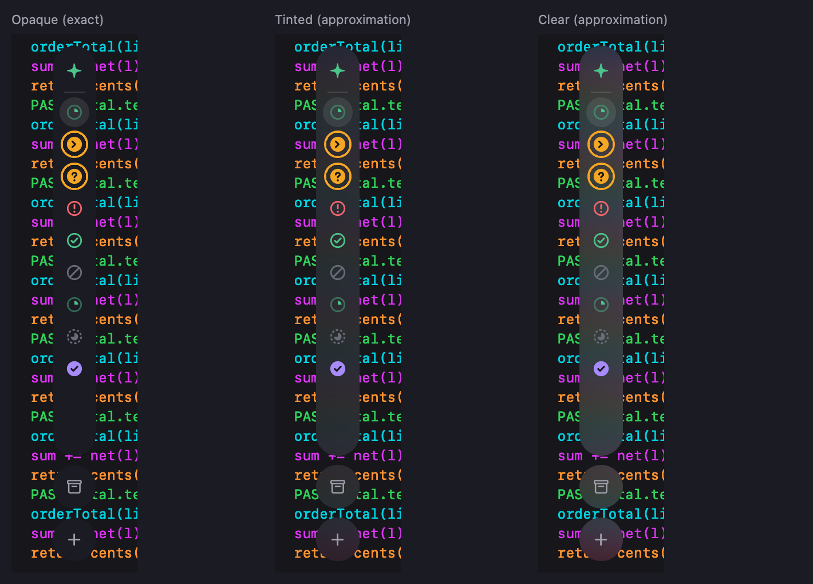
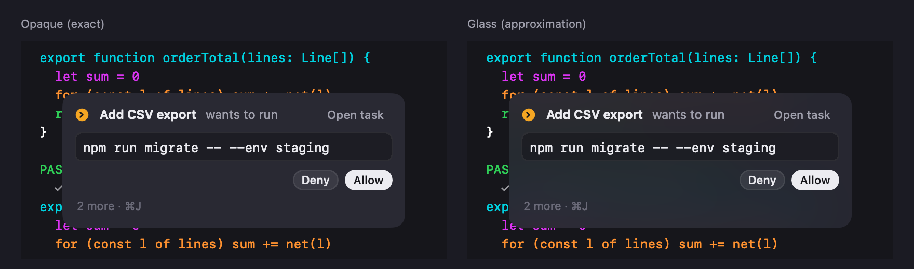

# Glass interface

> **Design record:** in progress. Phases 1 and 2 add tokens and views that nothing shows yet.\
> **Differs today:** the window has the sidebar, the collapsed rail of initials and the title bar buttons described in [Workspaces and columns](../workspaces-and-columns.md).

Status: design validated by the user on 2026-11-14, after six rounds of
studies (renders of today's app, mockups and the plan:
https://claude.ai/artifact/S1Mskjabz7pxZYzeNYg5yX). Built in 18 pull
requests; phases 1 and 2 run while the Board's swap ends.

## Decided

- **Layout, "Plein cadre":** the columns fill the window. One command bar
  floats at the top: the space, the current task and its state, ⌘P, and the
  count of agents waiting for the user (⌘J). On the left, a rail of state
  icons unfolds into a glass sidebar that pushes the columns aside; no text
  sits under glass. The sidebar folds by itself when the window is narrow.
- **Requests while the sidebar is folded:** nothing opens by itself. An
  agent waiting for the user rings its rail icon in amber and counts on the
  badge. A click on an amber icon opens that request in a callout anchored to
  the icon; "Open task" or a double-click goes to the task, and a click on an
  icon without amber goes to the task as today. ⌘J or a click on the badge
  opens the inbox under the command bar, oldest request first; ⌘J again goes
  to that task. Answers are clicks only, never a single key (decided with
  #358). With the sidebar unfolded, requests stay in the rows and ⌘J goes
  straight to the task. The edge pill of M3 (the name of an agent out of
  view) goes; the edge light stays.
- **Transparency:** four levels in Settings › Appearance, Opaque, Tinted,
  Glass and Clear (`InterfaceTransparency`). Tinted becomes the default only
  once an energy measurement confirms it; until then nothing changes. Opaque
  draws no glass at all, and Reduce transparency and Increase contrast make
  everything opaque. What floats over the work keeps a thick background: no
  glass on glass. The values each level draws with come with the glass view,
  tuned on renders: `NSGlassEffectView` takes a style and a tint, while the
  macOS 14 and 15 frost has no tint of its own (`GlassView` lays one over it).
- **Terminals:** opaque by default, with their own opacity slider apart from
  the interface, a floor at 60 % and Ghostty's minimum contrast. It touches
  the terminal engine: lane 3.
- **State icons:** one family everywhere: a ring filled by the Board's
  stations (Code, Reviews, Checks, Merge), coloured by the state, with a glyph
  for the reason (a command, a question, a failure, a block, a merge). Amber
  still means an agent waits for the user, and nothing else.
- **Settings:** one window for the app and the space.
- **No new literals:** font sizes, corner radii and shadows written as numbers
  outside `Theme` may not grow in any file (`ThemeGuardTests`); the glass
  views add the tokens they need. The Board's and the merge queue's files
  join once the Board's swap is done.
- **macOS:** the minimum stays macOS 14. Glass (`NSGlassEffectView`) from
  macOS 26; a frosted `NSVisualEffectView` on macOS 14 and 15. CI builds with
  Xcode 26.3 on macOS 15, so glass is proven by offscreen renders on a newer
  Mac, never by CI. macOS 27's concentric corners
  (`NSView.cornerConfiguration`) wait for Xcode 27 on CI: computed by hand
  meanwhile, from the window's radius measured on renders.

## Glass view

`GlassView` draws the glass: `NSGlassEffectView` on macOS 26 and later (the
content sits inside it), a frosted `NSVisualEffectView` with a tint on top on
macOS 14 and 15, a solid fill at Opaque. The chrome lets more through as the
level rises; what floats over the work keeps a thick tint at every level and
the floating shadow (left to the system on macOS 26). The tints are
provisional: an offscreen capture can't show either material, so the render
below approximates them (the content under the panel blurred, then the
view's tint) beside the exact Opaque render, and they get tuned with the user
on a demo at the end of phase 2. The view follows macOS's Reduce transparency and Increase
contrast as they change, and keeps the keyboard where it was when its content
moves into or out of macOS 26's glass. A floating glass in a window of its
own (⌘P's panel) is made with `fillsWindow`: its frost blends what is behind
the window, and the window casts the shadow, which a layer would have cut at
the window's edge.

## Button

`NiruxButton` is the one button: a capsule, 24 or 20 pt, primary (a light
slab for the one action a view is for), secondary, quiet, danger, and glass
(macOS 26's own glass bezel; the secondary look on 14 and 15). It is never
amber. A click leaves the keyboard where it was unless the button is created
`focusable` (a sheet's, Settings' buttons). For the rows (3.4): the sidebar's
drawn Allow / Deny / Yes / No take their colours from `NiruxButton.look` and
its small size, so the rows, the inbox and the callout show the same buttons.
A button can refuse a press (`acceptsPress`): the inbox's answers ignore
clicks for a moment after they move under the pointer, as the rows' buttons
do.

## Command bar

`CommandBarView` is the bar at the top of the window, on chrome glass: the
space (its colour square, its name, the space menu), the task on screen (its
state icon, its title, where it stands), the search (⌘P), and how many agents
wait for the user (an amber count and ⌘J), shown only while one waits. Each
segment is a quiet `NiruxButton` underneath, for its hover, its click and
what VoiceOver says. When the bar narrows, the task's title keeps 120 pt
before anything goes: first its detail, then the space's name (cut past
160 pt before that), then the search's key, then the waiting count's key; the
signs always stay. For phase 3: the segments' buttons don't drag the window,
so the bar keeps a strip to drag by (or the task segment drags after a short
move), and the window needs a taller title bar (an empty unified toolbar) for
the 36 pt capsule to sit level with the traffic lights.

## Icon rail

`IconRail` is the folded sidebar: a 38 pt glass capsule with the space's Lead
first (its sparkle, in its state's colour), a line, then one state icon per
task in the sidebar's order, 28 pt apart; under it, two round glass buttons
for the archived tasks and a new task. The task on screen wears a halo and
stays in view as the list scrolls (without scrollers); the pointer wears a
fainter one; a task whose agent waits for the user wears an amber ring, apart
from the icon. A click on an amber icon asks for its request (the callout,
2.3), anchored to the icon's view so that it follows the icon; a double-click
goes to the task, and the callout closes as the task opens. A click on any
other icon goes to the task, even in a window in the background, as today.
Names show in a tooltip; VoiceOver reads each icon as a button, its name and
its state, in the rail's order, hears a state change, and offers "Open task"
on an amber icon. For phase 3: what today's rail does beyond this (its menus,
dragging, the archived count) comes with the swap, and the demo at the end of
phase 2 checks whether macOS 26 wants the rail's three glass shapes in one
`NSGlassEffectContainerView`.

## Inbox and callout

The requests of agents waiting for the user, in two places: `RequestInboxView`
under the command bar (⌘J or the badge; every request, oldest first, the
oldest chosen; ↑ ↓ move the choice and ⌘J again goes to its task) and
`RequestCalloutView` beside a rail icon (one request, "Open task", how many
more wait). Both close on Escape and show the same `RequestCardView`: the
task (its state icon, its title, what the agent wants, how long it has
waited), the request (the exact command in its box, wrapped at its width;
the question), then its answers. A request only the terminal answers (a
question dialog, a folder's trust) says so, and the inbox adds "Open task".

One code answers: `RequestChoices` gives each request its buttons, their
words, their order and what stands in for them ("Allowing…", "Not delivered
— answer in the terminal"), for the rows' blocks as for the cards, and every
answer goes to the receiver the rows use. The rows' click rule holds too: a
single click, on a button that has sat still for 0.6 s (`RequestArming`,
the same rearming as the rows'), so that a request arriving, moving up or
taking another's place never takes a click aimed at what was there; a
scroll or the panel opening (the host calls `opened()`, which also chooses
the oldest) restarts the wait, and the answers that slid on screen as the
panel or its window moved wait again (a resize from the top moves none); a
release answers the request its press was on, never another that took the
card meanwhile. A chosen request answered elsewhere leaves the choice to the next
one still listed, and the list stays where it is. The question and its
choices take the rows' text and items (`SidebarQuestionText`), so a row and
a card show the same lines. A card belongs to its request, never to its task: its id comes
from the request (the permission's id, the question's column and time), so a
request that takes another's place gets a new card. Answers stay clicks; the
keyboard only moves the inbox's choice. For phase 3: the hosting (a popover
or a child window, the arrow), the order (`WaitingAgentQueue`, which doesn't
know Missions questions yet), and where `onAnswer` lands
(`decidePermission`, `answerFromCard`, `showMissionReplyPopover`) with the
request's column; the Missions reply panel should check the question's id,
as it opens whatever question its column holds.

## ⌘P under the bar

`CommandPalette.show(relativeTo:sections:placement:)` with `.underBar(bar,
level:)` hangs the palette 8 pt under the command bar (the bar's view: the
palette finds it on screen), centred on it, inside its window and on the screen,
at today's size; it unfolds from the bar (not under Reduce motion), and the field and
the rows sit on floating glass that fills the panel. While the bar shows
nowhere, the palette opens centred. Today's centred palette stays the
default and doesn't change. A press on the bar's search segment closes an
open palette, as the title bar's Search does. The scopes (tasks, sessions,
files, actions) come later. For the demo at the end of phase 2: macOS 26's
glass in a window of its own (that it shows what is behind the window, and
whether the window's shadow doubles its edge). For phase 3: the level
follows Settings as the other views' do, set by the host.

## Plan

1. Foundations, nothing on screen: tokens and the transparency levels, the
   state icons, the glass view with its fallback, one button.
2. Views built but not shown: the command bar, the icon rail, the inbox and
   the rail's callout, ⌘P under the bar. Renders go to the user before
   phase 3.
3. The swap: the window and the command bar, the rail and the sidebar, the
   requests and ⌘J, the rows on glass.
4. One Settings window, the Appearance page and the translucent window, the
   terminals' opacity.
5. The Board with the shared icons (after its own swap), hard-coded values,
   removals.
