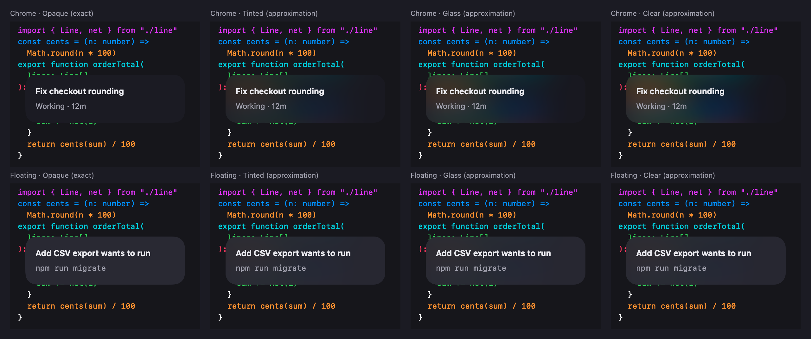

# Glass interface

> **Design record:** in progress. Phases 1 and 2 add tokens and views that nothing shows yet.\
> **Differs today:** the window has the sidebar, the collapsed rail of initials and the title bar buttons described in [Workspaces and columns](../workspaces-and-columns.md).

Status: design validated by the user on 2026-11-14, after six rounds of
studies (renders of today's app, mockups and the plan:
https://claude.ai/artifact/S1Mskjabz7pxZYzeNYg5yX). Built in 18 pull
requests; phases 1 and 2 run while the Board's swap ends.

## Decided

- **Layout, "Plein cadre":** the columns fill the window. One command bar
  floats at the top: the space, the current task and its state, ⌘P, and the
  count of agents waiting for the user (⌘J). On the left, a rail of state
  icons unfolds into a glass sidebar that pushes the columns aside; no text
  sits under glass. The sidebar folds by itself when the window is narrow.
- **Requests while the sidebar is folded:** nothing opens by itself. An
  agent waiting for the user rings its rail icon in amber and counts on the
  badge. A click on an amber icon opens that request in a callout anchored to
  the icon; "Open task" or a double-click goes to the task, and a click on an
  icon without amber goes to the task as today. ⌘J or a click on the badge
  opens the inbox under the command bar, oldest request first; ⌘J again goes
  to that task. Answers are clicks only, never a single key (decided with
  #358). With the sidebar unfolded, requests stay in the rows and ⌘J goes
  straight to the task. The edge pill of M3 (the name of an agent out of
  view) goes; the edge light stays.
- **Transparency:** four levels in Settings › Appearance, Opaque, Tinted,
  Glass and Clear (`InterfaceTransparency`). Tinted becomes the default only
  once an energy measurement confirms it; until then nothing changes. Opaque
  draws no glass at all, and Reduce transparency and Increase contrast make
  everything opaque. What floats over the work keeps a thick background: no
  glass on glass. The values each level draws with come with the glass view,
  tuned on renders: `NSGlassEffectView` takes a style and a tint, while the
  macOS 14 and 15 frost has no tint of its own (`GlassView` lays one over it).
- **Terminals:** opaque by default, with their own opacity slider apart from
  the interface, a floor at 60 % and Ghostty's minimum contrast. It touches
  the terminal engine: lane 3.
- **State icons:** one family everywhere: a ring filled by the Board's
  stations (Code, Reviews, Checks, Merge), coloured by the state, with a glyph
  for the reason (a command, a question, a failure, a block, a merge). Amber
  still means an agent waits for the user, and nothing else.
- **Settings:** one window for the app and the space.
- **No new literals:** font sizes, corner radii and shadows written as numbers
  outside `Theme` may not grow in any file (`ThemeGuardTests`); the glass
  views add the tokens they need. The Board's and the merge queue's files
  join once the Board's swap is done.
- **macOS:** the minimum stays macOS 14. Glass (`NSGlassEffectView`) from
  macOS 26; a frosted `NSVisualEffectView` on macOS 14 and 15. CI builds with
  Xcode 26.3 on macOS 15, so glass is proven by offscreen renders on a newer
  Mac, never by CI. macOS 27's concentric corners
  (`NSView.cornerConfiguration`) wait for Xcode 27 on CI: computed by hand
  meanwhile, from the window's radius measured on renders.

## Glass view

`GlassView` draws the glass: `NSGlassEffectView` on macOS 26 and later (the
content sits inside it), a frosted `NSVisualEffectView` with a tint on top on
macOS 14 and 15, a solid fill at Opaque. The chrome lets more through as the
level rises; what floats over the work keeps a thick tint at every level and
the floating shadow (left to the system on macOS 26). The tints are
provisional: an offscreen capture can't show either material, so the render
below approximates them (the content under the panel blurred, then the
view's tint) beside the exact Opaque render, and they get tuned with the user
on a demo at the end of phase 2. The view follows macOS's Reduce transparency and Increase
contrast as they change, and keeps the keyboard where it was when its content
moves into or out of macOS 26's glass. A floating glass in a window of its
own (⌘P if it stays a panel) needs blending behind the window and no layer
shadow: step 2.4 adds that if it does.

## Plan

1. Foundations, nothing on screen: tokens and the transparency levels, the
   state icons, the glass view with its fallback, one button.
2. Views built but not shown: the command bar, the icon rail, the inbox and
   the rail's callout, ⌘P under the bar. Renders go to the user before
   phase 3.
3. The swap: the window and the command bar, the rail and the sidebar, the
   requests and ⌘J, the rows on glass.
4. One Settings window, the Appearance page and the translucent window, the
   terminals' opacity.
5. The Board with the shared icons (after its own swap), hard-coded values,
   removals.
