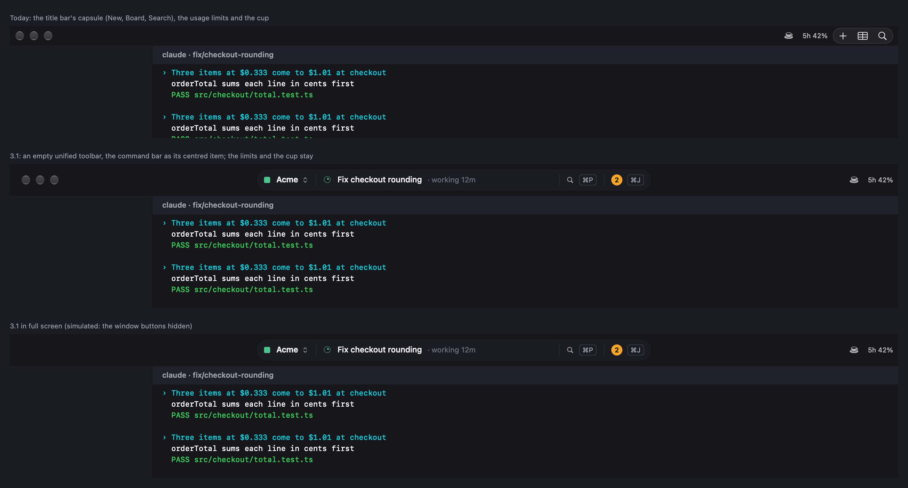
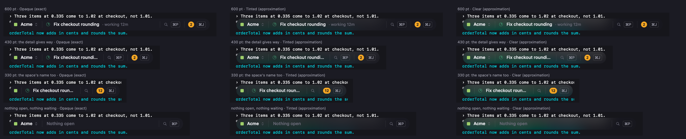
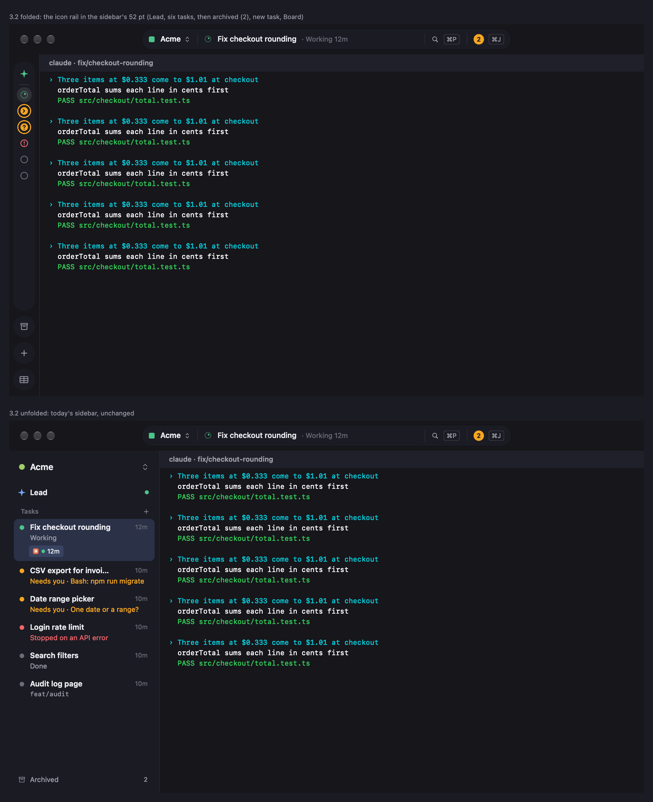
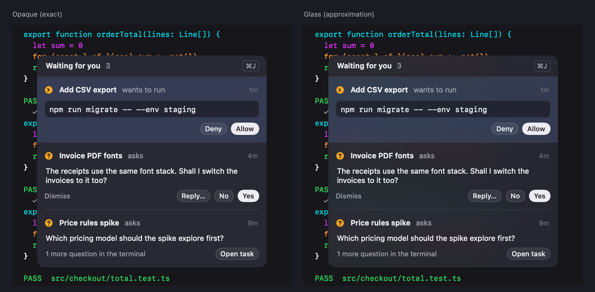
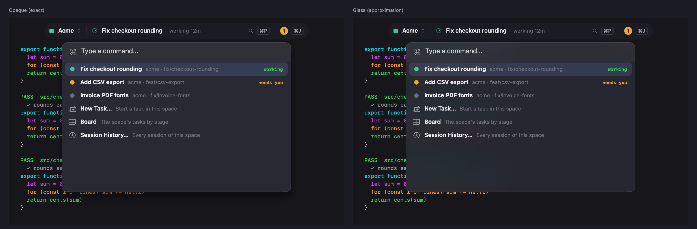

# Glass interface

> **Design record:** in progress. Phases 1 and 2 add tokens and views; phase 3 puts them in the window: the command bar (3.1), the icon rail as the folded sidebar (3.2), the requests and the new ⌘J (3.3), the rows on glass (3.4); phase 4 brings one Settings window (4.1), the Appearance pane and the translucent window (4.2), the terminals' opacity (4.3).\
> **Differs today:** Opaque stays the default until the energy bench and the user say Tinted.

Status: design validated by the user on 2026-11-14, after six rounds of
studies (renders of today's app, mockups and the plan:
https://claude.ai/artifact/S1Mskjabz7pxZYzeNYg5yX). Built in 18 pull
requests; phases 1 and 2 run while the Board's swap ends.

## Decided

- **Layout, "Plein cadre":** the columns fill the window. One command bar
  floats at the top: the space, the current task and its state, ⌘P, and the
  count of agents waiting for the user (⌘J). On the left, a rail of state
  icons unfolds into a glass sidebar that pushes the columns aside; no text
  sits under glass. The sidebar folds by itself when the window is narrow.
- **Requests while the sidebar is folded:** nothing opens by itself. An
  agent waiting for the user rings its rail icon in amber and counts on the
  badge. A click on an amber icon opens that request in a callout anchored to
  the icon; "Open task" or a double-click goes to the task, and a click on an
  icon without amber goes to the task as today. ⌘J or a click on the badge
  opens the inbox under the command bar, oldest request first; ⌘J again goes
  to that task. Answers are clicks only, never a single key (decided with
  #358). With the sidebar unfolded, requests stay in the rows and ⌘J goes
  straight to the task. The edge pill of M3 (the name of an agent out of
  view) goes; the edge light stays.
- **Transparency:** four levels in Settings › Appearance, Opaque, Tinted,
  Glass and Clear (`InterfaceTransparency`). Tinted becomes the default only
  once an energy measurement confirms it; until then nothing changes. Opaque
  draws no glass at all, and Reduce transparency and Increase contrast make
  everything opaque. What floats over the work keeps a thick background: no
  glass on glass. The values each level draws with come with the glass view,
  tuned on renders: `NSGlassEffectView` takes a style and a tint, while the
  macOS 14 and 15 frost has no tint of its own (`GlassView` lays one over it).
- **Terminals:** opaque by default, with their own opacity slider apart from
  the interface, a floor at 60 % and Ghostty's minimum contrast. It touches
  the terminal engine: lane 3.
- **State icons:** one family everywhere: a ring filled by the Board's
  stations (Code, Reviews, Checks, Merge), coloured by the state, with a glyph
  for the reason (a command, a question, a failure, a block, a merge). Amber
  still means an agent waits for the user, and nothing else.
- **Settings:** one window for the app and the space.
- **No new literals:** font sizes, corner radii and shadows written as numbers
  outside `Theme` may not grow in any file (`ThemeGuardTests`); the glass
  views add the tokens they need. The Board's and the merge queue's files
  join once the Board's swap is done.
- **macOS:** the minimum stays macOS 14. Glass (`NSGlassEffectView`) from
  macOS 26; a frosted `NSVisualEffectView` on macOS 14 and 15. CI builds with
  Xcode 26.3 on macOS 15, so glass is proven by offscreen renders on a newer
  Mac, never by CI. macOS 27's concentric corners
  (`NSView.cornerConfiguration`) wait for Xcode 27 on CI: computed by hand
  meanwhile, from the window's radius measured on renders.

## Appearance and the translucent window

Settings › Appearance (4.2), second in Nirux's panes, holds how Nirux looks
and moves:

- **Interface:** four tiles, Opaque, Tinted, Glass and Clear, as macOS's own
  Appearance pane shows Light and Dark. Each is a miniature drawn in code: the
  sidebar and the bar at the level's tint over an invented desktop, a column
  of work solid. One line says what the level picked shows. VoiceOver reads
  a radio group; with Full Keyboard Access, ← and → pick. A pick applies at
  once and is saved (`settings.interfaceTransparency`, a raw string a newer
  build's level survives). While Reduce transparency or Increase contrast is
  on, a line says Nirux draws opaque, and the tiles stay pickable.
- **Terminals** (4.3): a "Background" slider from 60 to 100%, by fives,
  100% by default, apart from the interface's level; the terminals follow it
  at every step, and it is saved once it stays still. Below 100% each
  terminal column of the task on screen lies on a frost of its own
  (behind-window, in place of the canvas fill, once the terminal draws its
  first frame) and Ghostty draws the terminal's background at that opacity
  over it (`background-opacity`, with `background-opacity-cells` so that a
  TUI's own backgrounds take it too: a per-terminal override applied live), so
  "80%" is 80% over the desktop's blur at any interface level, with no
  window tint stacked under it. Text keeps a minimum contrast of 3 unless the
  terminal's own Ghostty config sets one; Ghostty's own `background-opacity` and
  `background-blur` aren't used. Reduce transparency and Increase contrast
  keep the terminals opaque, and the section says so; editor, web, Board and
  review columns stay opaque. The window is non-opaque only while a terminal
  of the task on screen is.
- **Animate the interface**, moved here from General.

**The window.** `MainWindowContent` lies under the whole window, title bar
included (a full-size content view); the shell sits below the toolbar.
Above Opaque, one behind-window frost (`NSVisualEffectView`) tinted with the
canvas at the level's chrome alpha lets the desktop through, and the window
turns non-opaque; the canvas and the sidebar let that frost show. The chrome
lies on it: macOS 26's glass (kept until the user's look and the bench; else
tint and rim as on 14 and 15), or on macOS 14 and 15 only its rim, so that
one level reads the same on the bar, the rail and the open sidebar, and
nothing blurs twice. The window and its glass draw the level through one
resolver (the shell's). What floats in a window of its own (the
inbox, a callout, ⌘P) keeps its frost and its thick tint, and its window
casts the shadow. Every column is opaque under its content (the canvas's
colour, as before), so a terminal before
its first frame or a page still loading never shows the desktop; the
terminals' own opacity is 4.3. An inactive window goes flat, as macOS's own
do. Reduce transparency and Increase contrast make the window opaque at
once. The Settings window and the other panels stay opaque.

**Energy.** Tinted becomes the default only if, against Opaque, it adds at
most 2 points of WindowServer CPU and 20 % of GPU time, medians, measured
idle and with a terminal printing, the levels interleaved (Opaque, Tinted,
Glass, Clear, then back). The user runs the bench; the default flips only
with their OK.

## Glass view

`GlassView` draws the glass: `NSGlassEffectView` on macOS 26 and later (the
content sits inside it), a frosted `NSVisualEffectView` with a tint on top on
macOS 14 and 15, a solid fill at Opaque. The chrome lets more through as the
level rises; what floats over the work keeps a thick tint at every level and
the floating shadow (left to the system on macOS 26). The tints are
provisional: an offscreen capture can't show either material, so the render
below approximates them (the content under the panel blurred, then the
view's tint) beside the exact Opaque render, and they get tuned with the user
on a demo at the end of phase 2. The view follows macOS's Reduce transparency and Increase
contrast as they change, and keeps the keyboard where it was when its content
moves into or out of macOS 26's glass. A floating glass in a window of its
own (⌘P's panel) is made with `fillsWindow`: its frost blends what is behind
the window, and the window casts the shadow, which a layer would have cut at
the window's edge.

## Button

`NiruxButton` is the one button: a capsule, 24 or 20 pt, primary (a light
slab for the one action a view is for), secondary, quiet, danger, and glass
(macOS 26's own glass bezel; the secondary look on 14 and 15). It is never
amber. A click leaves the keyboard where it was unless the button is created
`focusable` (a sheet's, Settings' buttons). For the rows (3.4): the sidebar's
drawn Allow / Deny / Yes / No take their colours from `NiruxButton.look` and
its small size, so the rows, the inbox and the callout show the same buttons.
A button can refuse a press (`acceptsPress`): the inbox's answers ignore
clicks for a moment after they move under the pointer, as the rows' buttons
do.

## Rows on glass

The unfolded sidebar (3.4) keeps November's readable rows, their lines and
their motions (the working line, the turn's check, the ready check, the
merge sweep, the birth), and changes what frames them:

- **State icons:** each row's mark is its `StateIcon` at 14 pt, centred where
  the dot was, so the text doesn't move; a wait's reason comes from the
  column the row opens on, as on the rail. Checks that run show an arc that
  turns at the family's size while rows may move, and the family's dashed
  ring (`StateIcon`'s waiting icon) while they may not: Reduce motion, a
  window out of sight, an archived task. The catch-up card shows the same
  icons. The Lead keeps its sparkle; its state is a 12 pt icon at the end of
  its line.
- **Selection:** the selected row lies on a pane of glass: a white fill at
  10 %, a 1 pt rim (`line`) and the light on its top edge (`lineStrong`),
  at every level, Opaque included.
- **Buttons:** the rows' drawn Allow / Deny / Yes / No / Dismiss take
  `NiruxButton.look`'s colours and its small size, in a capsule.
- **Navigator rows (3.4b):** the sidebar navigates the main area, as Linear,
  Mail and Finder do: a row is selected only while what it shows is shown.
  **Board**, under the space's header, opens the space's Board column or
  brings it up. While that column shows on screen it reads open: its symbol
  in the accent, its title bright ("Board, open"; the rail's Board button
  too), so a click from the agent to the Board beside it changes nothing.
  The selection's glass stays the task's, whose workspace the main area
  shows: one selection, as in Mail (the user's call, 2026-11-16: "the best,
  UX-wise"). It can't be pressed while no task is open (its tooltip says
  so), and then takes the click and does nothing. It follows the columns as
  they are laid out (scrolled, resized, moved).
  Both rows scroll with the list, as in Mail and Finder. **History**, at the bottom with Archived
  above it, opens the Session History panel and is never selected. They
  replace 3.4's Tasks · Board · History capsule, which looked like tabs
  ("Tasks" stayed selected) while its other segments opened things
  elsewhere; the list gets its 50 pt back. `hitArea` and `cardIndex` answer
  only where the list shows; a dragged row stays in the part of the list in
  view.
- **Background:** the sidebar's glass behind the list comes in phase 4 with
  the interface's level: at Opaque it is the sidebar's colour.

## Command bar

`CommandBarView` is the bar at the top of the window, on chrome glass: the
space (its colour square, its name, the space menu), the task on screen (its
state icon, its title, where it stands), the search (⌘P), and how many agents
wait for the user (an amber count and ⌘J), shown only while one waits. Each
segment is a quiet `NiruxButton` underneath, for its hover, its click and
what VoiceOver says. When the bar narrows, the task's title keeps 120 pt
before anything goes: first its detail, then the space's name (cut past
160 pt before that), then the search's key, then the waiting count's key; the
signs always stay. In the window (3.1, `CommandBarToolbar`), the bar is the
centred item of an empty unified toolbar: the title bar grows from 32 to
52 pt and sets it level with the traffic lights, the empty strip on either
side drags the window (the segments' buttons don't), and the toolbar stays
in full screen. The space segment opens the space menu, the task segment the
task's menu (its row's ⋯), the search ⌘P under the bar, and the count does
what ⌘J does (the inbox, below); with nothing open,
the task segment opens the New sheet. The count is what ⌘J reaches, in every
space, that waits for the user's answer (amber): not the agents stopped on an
error or exited, which ⌘J also visits, nor the column on screen, which it
never goes to. The task's detail is its row's status as the row says it
("Working 12m", the turn's time only while it works). In full screen AppKit
moves the toolbar into a window of its own, which ⌘P's placement accepts. On macOS 26 the bar's toolbar item asks for no glass of the
system's (not bordered, the plain style): the bar draws its own. The usage
limits and the cup stay at the toolbar's right end. The title bar's New,
Board and Search buttons went: New is in the sidebar and ⌘N, the Board is an
icon at the bottom of the rail (3.2).

## Icon rail

`IconRail` is the folded sidebar: a 38 pt glass capsule with the space's Lead
first (its sparkle, in its state's colour), a line, then one state icon per
task in the sidebar's order, 28 pt apart; under it, round glass buttons for
the archived tasks (while there are some), a new task and, at the foot, the
Board. The task on screen wears a halo and
stays in view as the list scrolls (without scrollers); the pointer wears a
fainter one; a task whose agent waits for the user wears an amber ring, apart
from the icon. A click on an amber icon asks for its request (the callout,
2.3), anchored to the icon's view so that it follows the icon; a double-click
goes to the task, and the callout closes as the task opens. A click on any
other icon goes to the task, even in a window in the background, as today.
Names show in a tooltip; VoiceOver reads each icon as a button, its name and
its state, in the rail's order, hears a state change, and offers "Open task"
on an amber icon.

In the window (3.2) the rail sits in the folded sidebar's 52 pt, where the
rail of initials was, so the columns don't move; the cards' scroll view goes
while it shows. Each task's icon carries its initials in the ring (the user's
pick B after the before/after render, 2026-11-16, so that tasks at rest stay
apart without a hover), numbered over every task of the space (`TaskInitials`:
"CR", "CR2"), while the icon has no glyph to show: the amber and red glyphs
(an agent waiting for the user, one that failed) take the centre instead. With
initials, the ring keeps its colour and the station runs along it rather than
inside it, and the icons grow from 15 to 22 pt so that the letters read. It lists what the folded rows listed: the active tasks, and
of the archived ones the task on screen and those whose agent waits on the
user or broke, never the whole archived list (it has nowhere to show). Its
icons are the rows' states: the row's mark, a wait's reason from the column
that waits, and amber for a question a Mission child handed to the user. A
click on a task whose agent waits opens its request's callout, and a
double-click goes to the task; on any other task, a click goes to it. A right-click
opens the task's menu, which holds Rename; dragging and renaming in place
stay in the unfolded sidebar, and the rail of initials' rich tooltip goes for
a short one: the name and what the row says ("Needs you · Bash: npm run
migrate", "Stuck? · …"), or the icon's state where the row prints its
branch. The archived button unfolds the sidebar with the
Archived list open and its header in view (as View › Show Archived and ⌘P do
while folded); its tooltip counts them. The space tile went: the command
bar's space segment opens the same menu. The sidebar folds by itself below a
900 pt window (`SidebarFold`: 260 pt of sidebar would leave the columns less
than about 640 pt) and unfolds back from 940 pt (a window dragged about the
width doesn't make the columns jump) if the user's choice, which is what is
saved, is unfolded; a toggle while narrow is the user's choice until the
window gets wide and narrow again, and a first launch unfolds it for the
Getting Started checklist whatever the width. The fold that follows a resize
doesn't animate: the window's own resize moves the columns, and the cards
come in once the sidebar is wide. Folded, the sidebar takes
the window's colour, on which the capsule reads at Opaque (its colour is the
unfolded sidebar's).

The approved motions on the rail: a working agent's icon breathes, the Lead's
sign too, at most 15 frames a second (the sidebar's old dots' cap), and only
while the interface may move; a new task's ⌘N sheet folds onto its icon,
which opens with a spring as it lands while the icons under it give way (not
in a list that scrolls), as its row does unfolded. The rows' other moments (a
turn end's check and the working line of M5, the merge's sweep of M10) stay
the unfolded rows', as with the rail of initials; the icon shows the state
they end on (a grey check, a violet merged disc).

## Inbox and callout

The requests of agents waiting for the user, in two places: `RequestInboxView`
under the command bar (⌘J or the badge; every request, oldest first, the
oldest chosen; ↑ ↓ move the choice and ⌘J again goes to its task) and
`RequestCalloutView` beside a rail icon (one request, "Open task", how many
more wait). Both close on Escape and show the same `RequestCardView`: the
task (its state icon, its title, what the agent wants, how long it has
waited), the request (the exact command in its box, wrapped at its width;
the question), then its answers. A request only the terminal answers (a
question dialog, a folder's trust) says so, and the inbox adds "Open task".

One code answers: `RequestChoices` gives each request its buttons, their
words, their order and what stands in for them ("Allowing…", "Not delivered
— answer in the terminal"), for the rows' blocks as for the cards, and every
answer goes to the receiver the rows use. The rows' click rule holds too: a
single click, on a button that has sat still for 0.6 s (`RequestArming`,
the same rearming as the rows'), so that a request arriving, moving up or
taking another's place never takes a click aimed at what was there; a
scroll or the panel opening (the host calls `opened()`, which also chooses
the oldest) restarts the wait, and the answers that slid on screen as the
panel or its window moved wait again (a resize from the top moves none); a
release answers the request its press was on, never another that took the
card meanwhile. A chosen request answered elsewhere leaves the choice to the next
one still listed, and the list stays where it is. The question and its
choices take the rows' text and items (`SidebarQuestionText`), so a row and
a card show the same lines. A card belongs to its request, never to its task: its id comes
from the request (the permission's id, the question's column and time), so a
request that takes another's place gets a new card. Answers stay clicks; the
keyboard only moves the inbox's choice. For phase 3: the hosting (a popover
or a child window, the arrow), the order (`WaitingAgentQueue`, which doesn't
know Missions questions yet), and where `onAnswer` lands
(`decidePermission`, `answerFromCard`, `showMissionReplyPopover`) with the
request's column; the Missions reply panel should check the question's id,
as it opens whatever question its column holds.

In the window (3.3), decided with the Lead on 2026-11-16: the requests are
what ⌘J's queue (`WaitingAgentQueue`, through `waitingQueue`) holds that
waits for an answer (amber), the column on screen left out, and the Mission
questions handed to the user, which the queue now holds at their time; the
command bar's count is their number. The order is the queue's: the waits not
seen yet first, then the standing questions, oldest first in each, so that
⌘J again lands where ⌘J lands while the sidebar is unfolded. An agent
stopped on an error or exited (red) stays out: ⌘J walks to it as before when
no amber request waits. A request is built at each sidebar refresh from what
the rows read (`requestKind`: a handed-off Mission question, a permission
the rows answer, the turn's question, a question dialog, else a prompt only
the terminal answers). With the sidebar folded, ⌘J and the badge open the
inbox (over a callout, which closes); ⌘J again goes to the chosen request's
column; with it unfolded they go straight to the task, as before. Both
panels are borderless child windows of the main window (`RequestPanel`),
the inbox placed under the bar as ⌘P is, the callout right of its icon,
which it follows as the rail scrolls: while one has the keyboard, keys typed
reach no terminal (the key interceptor routes only the main window's), a
click elsewhere closes it, and Escape or the last answer gives the keyboard
back to the terminal. The inbox follows the refresh and closes once no
request is left; the callout closes once its request is gone (answered, or
its column on screen) or its icon is. Answers go to the rows' receivers
(`decidePermission`, `answerFromCard`, `showMissionReplyPopover`, which now
checks the question's id); "Open task" and ⌘J go to the request's column.
For Allow / Deny to show there, Nirux holds a permission while the sidebar
is folded too (decided with the Lead, 2026-11-16: the user chose the inbox
and the callout for answering, which a reader-only inbox would break):
folded, the requests of every column not on screen, in every space, are held
(`offersApprovalButtons`); unfolded, as before, only those a card shows.
The deadline and the release rules don't change: under VoiceOver nothing is
held, and a column that comes on screen hands its request back to its
terminal at that refresh, so that the terminal and a card never both answer.
After the reviews: the inbox opens on the request ⌘J's walk goes to next
(each once a round, as ⌘J unfolded), a request from another space names its
space ("Lead · Work"), Escape closes a panel on its release (a held key's
repeats must not reach the terminal that takes the keyboard back), a ⌘
shortcut other than ⌘J closes the panel before the menu acts, a panel that
loses the keyboard to another window closes (not for a reply popover a card
opened, which keeps its panel as it is through refreshes), and ⌘P and the
panels never show together. After the Lead's review: Escape and ⌘. are the
panel's own (`RequestPanel.onEscape`, on their release, whatever has the
keyboard in it, a card's button included); a press the panel let through
(the badge, the callout's icon) is followed until it ends, and a panel left
without the keyboard then closes (a press dragged off the badge), so a
visible panel always has the keyboard; folded, a background subagent's
request is held only while the inbox or the callout is open (its dialog
waits for the hook), the main thread's as above; a handed-off Mission
question read on screen stands after the waits not seen yet; the inbox's
choice and "Open task" go through `WaitingAgentQueue.next`, ⌘J's own rule;
the callout is capped as the inbox is, its card scrolling past the cap.

## ⌘P under the bar

`CommandPalette.show(relativeTo:sections:placement:)` with `.underBar(bar,
level:)` hangs the palette 8 pt under the command bar (the bar's view: the
palette finds it on screen), centred on it, inside its window and then on
the screen, at today's size; near the screen's bottom it opens above the bar
rather than over it. It unfolds from the bar (not under Reduce motion), and
the field and the rows sit inside floating glass that fills the panel (macOS
26's glass adapts what it holds). While nobody sees the bar (hidden,
transparent, in another window than the palette's, or its window ordered
out, minimized or on another Space), the palette opens centred. Today's centred palette stays the
default and doesn't change. A press on the bar's search segment closes an
open palette. The scopes (tasks, sessions,
files, actions) come later. For the demo at the end of phase 2: macOS 26's
glass in a window of its own (that it shows what is behind the window, and
whether the window's shadow doubles its edge). For phase 3: the level
follows Settings as the other views' do, set by the host, and the shell gives
the palette its `windowShows` from `ShellSideEffects`, so that flow tests,
whose windows never show, reach the placement under the bar.

## Settings

`SettingsWindow` is the one Settings window (4.1), for the app and the
space, in place of Settings' three toolbar tabs and Space Settings' seven:

- **Sidebar** (`SettingsSidebar`, a table, so ↑ ↓ walk the panes and
  VoiceOver reads a list): "Nirux" and its panes (General, Appearance,
  Agents, Notifications), then the space's colour square
  and name, a popup to pick another space, and its panes (General, Defaults,
  Lead, Brief, Memory, Board, Templates). Plain SF Symbols in the secondary
  text colour, no coloured tiles: colour stays for states. The pane shown
  lies on the selection's glass, as a selected task row does.
- **Panes** as they were in the tabs; their redesign is phase 5. The app
  builds Nirux's each time the window opens; the shell builds the space's
  (`SpaceSettingsSection`) and writes what they change.
- **One space at a time:** the active one, or the one whose Space Settings…
  was chosen. The popup lists the spaces as they are when it opens; from
  one of Nirux's panes it changes the space listed, not the pane. Text
  typed and not saved, or a sheet of the space's panes, up or queued (Add
  Repository…, a setup script, a question; the space's section records
  each until it ends), keeps its space: picking another shows that text and
  says why, in the window, over that sheet if one is up. A sheet of Nirux's own
  (the tasks folder's chooser) belongs to no space: it keeps none, and
  stays when the space shown is deleted, which gives way to the active
  space and ends the space's sheets; Nirux's pane shown stays. Closing and
  quitting ask, as before; the main window keeps what had its keyboard, or
  the task's terminal takes it if nothing had.
- **Keyboard:** the sidebar has it when the window opens, so ↑ ↓ walk the
  panes (over the space's header); Tab goes on into the pane shown. Memory
  and Board take it when Space Memory… or Board settings asks for them, at
  once if their content shows, else as it comes; one that can't (a Board
  file it can't write, no memory to list) leaves it with the sidebar, as
  they do when walked to from it.
- **Size:** fixed width (the sidebar and the widest pane, Memory's list),
  narrower panes centred, never wider than the screen; the height fits each
  pane, or the sidebar's list, top edge fixed.
- **Title:** the pane's ("Agents", "Acme — Brief").
- **Entry points:** ⌘, and Settings… open on the pane last shown (the
  first time, Nirux's General; a space's pane only for that same space,
  else Nirux's pane last shown); Space Settings… on the space's General;
  Board settings and Space Memory… on their panes.

## Columns as cards

From the depth study (2026-11-17, approved by the user: P1, 8 pt of air):
the columns rest on the window as cards. At rest only light gives depth;
the text stays flat and sharp.

- **Air:** `Theme.Space.sm` between the columns and around them
  (`WorkspaceState.columnGap`, `columnInset`). At Opaque the air is the
  canvas; from Tinted up, the desktop's frost shows through it. The resize
  handles straddle the air, and the camera brings the focused card in with
  its air.
- **Corners:** `Theme.Radius.column`, 10 pt circular: their clip stays
  within the terminals' 10 pt padding (#598), so it cuts no cell. Each
  column clips its content to them; a terminal's header, the terminal's
  own layer and its overlays also round their own, so that none of their
  content lies in the clipped corners. A translucent terminal's frost takes a mask of the shape, since
  blending behind the window ignores any clip.
- **Widths:** a width fraction spans the viewport less its edges' air plus
  one gap, so two halves fill the viewport whatever the number of columns.
- **In the middle** (the user's choice, 2026-11-18): cards that don't fill
  the viewport lie centred, a first terminal at its own width included,
  and a new one comes in there, as any new column does (a fade from 92 %).
  The camera does it, so a second column makes the strip glide aside, as
  it already slid. Dragging a centred card's edge widens it on both sides,
  so that the edge stays under the pointer.
- **Edge:** a hairline (`Theme.Color.line`) around each card; the focused
  one keeps its accent edge.
- **Shadow:** `Theme.Elevation.Level.column`, short enough to stay within
  the air, cast by a view of its own under every column of the strip
  (`ColumnShadowView`) along a path. Under an opaque card it is never
  masked, so that terminals redrawing over it cost no offscreen pass: the
  card hides its inside. A card the desktop shows through (a translucent
  terminal) takes its shape out of the shadow, as the floating glass does.
  The layout hides it while its card fades in or out.
- **Next (P1, second PR):** the focused card one level higher, its shadow
  passing from card to card when the focus moves.

## Plan

1. Foundations, nothing on screen: tokens and the transparency levels, the
   state icons, the glass view with its fallback, one button.
2. Views built but not shown: the command bar, the icon rail, the inbox and
   the rail's callout, ⌘P under the bar. Renders go to the user before
   phase 3.
3. The swap: the window and the command bar, the rail and the sidebar, the
   requests and ⌘J, the rows on glass.
4. One Settings window, the Appearance page and the translucent window, the
   terminals' opacity.
5. The Board with the shared icons (after its own swap), hard-coded values,
   removals.
